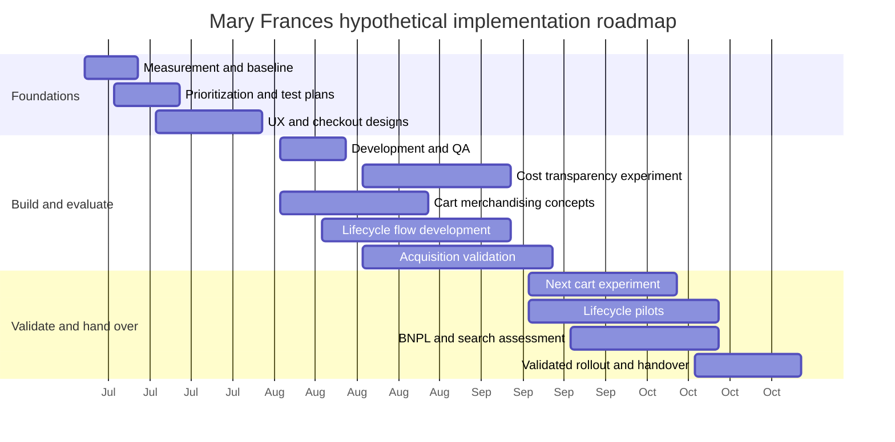

# Mary Frances Four Month CRO Roadmap

**Hypothetical retrospective reconstruction | July–October 2026**

Prepared by **Daniele Santoro · DS CRO Consulting**.

This portfolio planning example reconstructs how the recommendations in the June 2026 Mary Frances audit could have been delivered over the last four completed months. Dates, role assignments, sequencing and deliverables are illustrative. They are not evidence that work was executed, that experiments ran, or that results were achieved. Execution status for every item: **Not verified**.

## Objective and evidence

Reduce purchase friction while protecting contribution margin, beginning with reliable measurement and checkout cost transparency. The audit reports a 0.46% session-to-purchase rate across September 2025–May 2026 and flags March–April ATC anomalies. These are historical audit inputs, not verified July–October baselines. Re-establish the baseline before launch. No revenue uplift is claimed.

Source: [Mary Frances CRO Audit](https://diegoeleonardo.github.io/cro-consulting-clients/maryfrances-cro-audit/daniele-santoro/).

## Monthly delivery plan

| Month | Focus | Review gate |
|---|---|---|
| July 2026 | Measurement, prioritization and checkout/cart designs | Trustworthy baseline and approved experiment briefs |
| August 2026 | Development, QA, first experiment and lifecycle build | Tracking, UX, policy and rollout readiness |
| September 2026 | Experiment readouts, next cart test and lifecycle pilots | Evidence sufficient to decide or extend; margin protected |
| October 2026 | Validate, selectively roll out and hand over | Documented decisions, monitoring and next-quarter backlog |

## Work items

| ID | Work item | Start | Target finish | Suggested owner role | Priority | Dependencies |
|---|---|---|---|---|---|---|
| MF01 | Validate measurement and establish baseline | 2026-07-01 | 2026-07-10 | Analytics | P0 | None |
| MF02 | Prioritize hypotheses and define test plans | 2026-07-06 | 2026-07-17 | CRO strategy | P0 | MF01 |
| MF03 | Design cart cost transparency and checkout improvements | 2026-07-13 | 2026-07-31 | UX and Shopify development | P0 | MF01; MF02 |
| MF04 | Develop and QA cart and checkout experiment | 2026-08-03 | 2026-08-14 | Shopify development and QA | P0 | MF03 |
| MF05 | Evaluate cost-transparency experiment | 2026-08-17 | 2026-09-11 | CRO and analytics | P0 | MF04 |
| MF06 | Build cart reassurance and accessory concepts | 2026-08-03 | 2026-08-28 | UX and merchandising | P1 | MF02 |
| MF07 | Develop Remarkety lifecycle flows | 2026-08-10 | 2026-09-11 | Lifecycle marketing | P1 | MF01; MF02 |
| MF08 | Validate Meta and search acquisition strategy | 2026-08-17 | 2026-09-18 | Paid media and analytics | P1 | MF01; MF02 |
| MF09 | Test cart merchandising and mobile checkout CTA | 2026-09-14 | 2026-10-09 | CRO and Shopify development | P1 | MF05; MF06 |
| MF10 | Pilot lifecycle flows and measure incrementality | 2026-09-14 | 2026-10-16 | Lifecycle marketing and analytics | P1 | MF07 |
| MF11 | Assess BNPL and search expansion feasibility | 2026-09-21 | 2026-10-16 | CRO and commercial operations | P2 | MF05; MF08 |
| MF12 | Roll out validated changes and deliver handover | 2026-10-12 | 2026-10-30 | CRO lead and client team | P0 | MF05; MF09; MF10; MF11 |

## Delivery timeline

## Scope and acceptance criteria

### MF01 Validate measurement and establish baseline

Reconcile Shopify completed online-store orders; audit March-April ATC duplication; segment by device and channel.

**Acceptance gate:** Signed-off event QA and baseline dashboard; historical anomalies annotated.

### MF02 Prioritize hypotheses and define test plans

Rank shipping transparency, cart friction, email and acquisition opportunities; define eligibility, randomization, MDE and stopping rules.

**Acceptance gate:** Approved backlog and experiment briefs; primary metric RPV with conversion, margin, AOV and performance guardrails.

### MF03 Design cart cost transparency and checkout improvements

Design shipping and tax estimates, delivery reassurance and express-payment hierarchy; assess form and opt-in changes within Shopify plan constraints.

**Acceptance gate:** Approved desktop/mobile designs; accurate estimates, policy copy and technical feasibility.

### MF04 Develop and QA cart and checkout experiment

Implement candidate changes in staging; verify regional estimates, checkout tracking, browser/device coverage, accessibility and rollback.

**Acceptance gate:** QA sign-off, no duplicate events and documented rollback before exposure.

### MF05 Evaluate cost-transparency experiment

Run a controlled experiment if traffic supports the agreed sample; monitor checkout completion, RPV and contribution margin.

**Acceptance gate:** Decision memo with confidence intervals and guardrails; extend or retain control if inconclusive.

### MF06 Build cart reassurance and accessory concepts

Prototype free-shipping threshold/progress, theme-matched accessories, collapsed notes and mobile checkout CTA.

**Acceptance gate:** Margin-approved threshold and prototype QA; test separately from MF05 unless mutually exclusive.

### MF07 Develop Remarkety lifecycle flows

Design browse abandonment, post-purchase cross-sell, VIP access and 60/90/120-day win-back triggers.

**Acceptance gate:** Consent, suppression, product feeds and deliverability verified; holdouts defined. Long win-back outcomes may extend beyond October.

### MF08 Validate Meta and search acquisition strategy

Review attribution, campaign intent and new/returning cohorts; test controlled retargeting and search allocations after signal QA.

**Acceptance gate:** Budget decision based on incrementality, CAC and contribution margin; no automatic switch based only on channel averages.

### MF09 Test cart merchandising and mobile checkout CTA

Test the next highest-priority cart hypothesis sequentially; confirm any shipping incentive preserves margin.

**Acceptance gate:** Experiment readout; implementation conditional on sample sufficiency and guardrails.

### MF10 Pilot lifecycle flows and measure incrementality

Stage eligible flow launches; monitor holdouts, revenue per recipient, unsubscribes and complaints.

**Acceptance gate:** Flow-level decision log; separate observed early results from immature 60/90/120-day cohorts.

### MF11 Assess BNPL and search expansion feasibility

Assess provider fees, payment eligibility, checkout compatibility and search expansion economics.

**Acceptance gate:** Go/no-go business case; pilot only after commercial and technical approval.

### MF12 Roll out validated changes and deliver handover

Release only validated changes with monitoring; compile experiment decisions, unresolved hypotheses, playbook and next-quarter backlog.

**Acceptance gate:** Documented release/rollback checklist and stakeholder readout; no assumed uplift or completion claims.

## Measurement and operating cadence

- Primary business metric: revenue per eligible session; checkout-focused tests also track checkout completion.
- Guardrails: contribution margin, AOV, refunds, checkout errors, mobile performance, email unsubscribes/complaints and acquisition efficiency.
- Weekly: review measurement quality, delivery blockers, experiment health and decisions. Record decisions and dependencies rather than retroactively marking work Done.
- Experiments: calculate sample size from the validated baseline; predefine stopping rules and confidence level. Calendar finish dates are planning targets, not guarantees of statistical significance.
- Protect attribution: isolate simultaneous tests by audience/page or run sequentially. Use holdouts for lifecycle and acquisition where feasible.
- Publish policy and delivery claims only after client verification; checkout customization depends on Shopify plan and app capabilities.

## GitHub Project setup

Use Title, Client, Start date, Target date, Phase, Priority, Owner role, Dependencies and Evidence status fields. Set Client to Mary Frances and Evidence status to Hypothetical for all items. Keep the Project description explicit: “Hypothetical retrospective reconstruction; execution and results not verified.” Do not assign Done without actual delivery evidence.

The accompanying CSV is a transfer worksheet; it does not automatically populate GitHub Projects or set timeline fields. This file being in the repository does not mean Project 1 has been updated.
