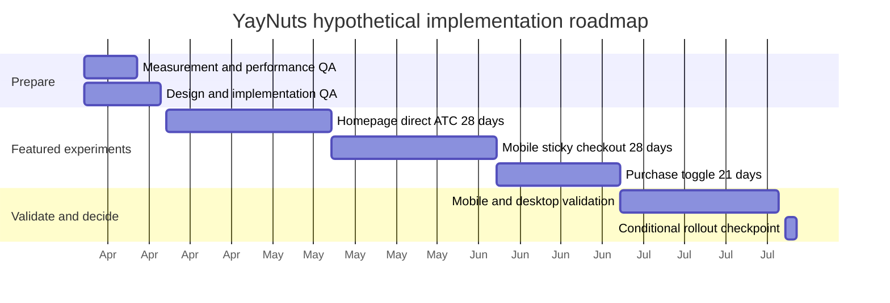

# YayNuts CRO Heuristic Audit Delivery Roadmap

**Hypothetical retrospective reconstruction | April–July 2026**

Prepared by **Daniele Santoro · DS CRO Consulting**.

This roadmap follows the March 2026 report's recommendations, featured experiment durations and next-step logic. April–July is an assumed four-month implementation window following the audit, not a documented historical schedule. Execution and achieved results are **Not verified**.

## Source and evidence

[YayNuts Site CRO Heuristic Audit](https://diegoeleonardo.github.io/cro-consulting-clients/yaynuts-site-cro-heuristic-audit/daniele-santoro/).

- Pages 15–17: experiment ideas, UX recommendations and impact/effort/confidence prioritization.
- Pages 19–20: homepage direct ATC example, 28-day test.
- Pages 21–22: mobile sticky checkout example, 28-day test.
- Pages 23–24: purchase toggle example, 21-day test.
- Page 25: validate mobile hypotheses, fix desktop experience, scale only proven changes.

The example results on pages 20, 22 and 24 are labeled illustrative/simulated. They do not establish actual experiments, observed uplifts or statistical significance. Preserve that distinction when presenting this roadmap. The source has no calendar delivery deadlines for the full programme; only the featured test durations are carried over as stated.

## Monthly delivery plan

| Month | Focus | Exit gate |
|---|---|---|
| April | Measurement/mobile readiness, creative and development QA; begin homepage test | Valid baseline, approved variants and clean experiment exposure |
| May | Complete 28-day homepage window; begin 28-day mobile sticky checkout window | Evidence-based readout, or extend if inconclusive |
| June | Complete sticky checkout window; run 21-day purchase-toggle window | Device and audience analysis; do not assume a universal winner |
| July | Mobile validation, desktop-specific refinement and conditional rollout | Scale only validated changes; keep unresolved tests open |

## Work items

| ID | Deliverable | Start | Target finish | Audit reference and timing | Dependencies |
|---|---|---|---|---|---|
| YN01 | Validate measurement, mobile performance and test readiness | 2026-04-01 | 2026-04-10 | Planning prerequisite; p7, p17 | None |
| YN02 | Design and QA the three featured experiments | 2026-04-01 | 2026-04-14 | p19, p21, p23; dates assumed | YN01 before launch |
| YN03 | Homepage direct Add-to-Cart experiment | 2026-04-15 | 2026-05-12 | 28-day illustrative test; p19–20 | YN01; YN02 |
| YN04 | Mobile sticky checkout experiment | 2026-05-13 | 2026-06-09 | 28-day illustrative test; p21–22 | YN03 decision; YN02 |
| YN05 | Purchase options toggle experiment | 2026-06-10 | 2026-06-30 | 21-day illustrative test; p23–24 | YN04 decision; YN02 |
| YN06 | Validate mobile and first-time visitor hypotheses | 2026-07-01 | 2026-07-28 | Next steps p25; retest duration assumed | YN04; YN05 |
| YN07 | Design and evaluate desktop-specific purchase selector | 2026-07-01 | 2026-07-28 | Next steps p25; duration assumed | YN05 |
| YN08 | Roll out only validated changes and hand over | 2026-07-29 | 2026-07-31 | Next steps p25; checkpoint assumed | YN06; YN07 if conclusive |
| YN09 | Homepage, PDP and cart clarity improvements | 2026-04-01 | 2026-04-14 | UX recommendations p16; timing assumed | YN01 baseline |
| YN10 | Navigation and discovery backlog | 2026-07-01 | 2026-07-31 | p15–17; timing assumed | Core test learnings |
| YN11 | Cross-sell, personalized hero and checkout progress feasibility | 2026-07-01 | 2026-07-31 | p15–17; timing assumed | YN01; core test learnings |

## Delivery timeline

## Scope and acceptance criteria

### YN01 Validate measurement, mobile performance and test readiness

Confirm funnel events, revenue attribution, audience/device cohorts, mobile image loading and sample requirements. Investigate LCP before launch.

**Acceptance:** Verified baseline, event QA, feasibility and predefined sample/stopping rules.

### YN02 Design and QA the three featured experiments

Build direct homepage ATC cards, mobile sticky checkout CTA and one-time/subscription purchase toggle. Test cart, variant and subscription behavior.

**Acceptance:** Staging QA, exposure tracking, accessibility, device coverage and rollback approved.

### YN03 Homepage direct Add-to-Cart experiment

Replace Our Story section with shoppable product cards and direct ATC; preserve brand and product information.

**Acceptance:** 28-day planning window; RPV primary. Check orders, ATC, AOV and device cohorts; extend if sample insufficient.

### YN04 Mobile sticky checkout experiment

Keep checkout CTA visible in the mobile cart drawer; run sequentially to reduce funnel interaction with the homepage test.

**Acceptance:** RPV primary; checkout starts, cart abandonment, orders and usability guardrails.

### YN05 Purchase options toggle experiment

Simplify subscription versus one-time purchase choice; analyze mobile and desktop separately.

**Acceptance:** RPV primary; AOV, ATC, completed orders and subscription accuracy. Do not pool away device-level declines.

### YN06 Validate mobile and first-time visitor hypotheses

Retest sticky checkout and purchase-mode simplification, prioritizing mobile and first-time visitors.

**Acceptance:** Separate eligible cohorts or run sequentially; duration may extend beyond July. No win inferred from simulated slides.

### YN07 Design and evaluate desktop-specific purchase selector

Explore a desktop-specific selector and compare with the original rather than copying a modeled mobile winner.

**Acceptance:** Device-specific hypothesis, sufficient sample and RPV/ATC/AOV/order guardrails before scaling.

### YN08 Roll out only validated changes and hand over

Record decisions, release eligible winners gradually, monitor and preserve rollback. Carry inconclusive tests forward.

**Acceptance:** July is a review checkpoint, not a promise that retests finish or changes ship.

### YN09 Homepage, PDP and cart clarity improvements

Taste/natural-ingredient/family hero; lifestyle imagery; PDP close-ups and usage; remove repetition; raise ATC; optional protection toggle.

**Acceptance:** Approve assets/copy and cart behavior; freeze tested surfaces or isolate cohorts so changes do not contaminate experiments.

### YN10 Navigation and discovery backlog

Best Sellers/Gifts/Bundles groups, category thumbnails and flavor/size/occasion filters; evaluate usage showcase and multi-size merchandising.

**Acceptance:** Prioritized backlog and feasibility; not a blanket commitment to implement all by July.

### YN11 Cross-sell, personalized hero and checkout progress feasibility

Assess relevant cross-sells, personalized hero and progress indicators. Verify traffic for multivariate designs, consent for personalization and Shopify checkout constraints.

**Acceptance:** Commercial/technical go-no-go and separate test briefs; use genuine urgency only. Defer unsupported scope.

## Experiment operating rules

Use RPV as the primary business metric, consistent with the featured examples. Track AOV, add-to-cart and completed orders; monitor margin, errors, mobile performance and subscription accuracy. Sticky checkout also tracks checkout starts and abandonment.

Define eligible traffic, randomization unit, sample size/MDE and stopping rules before exposure. The examples use paid PPC/social traffic; their sample counts and results cannot substitute for current traffic estimates. Analyze desktop/mobile and first-time/returning cohorts with appropriate uncertainty; do not call a subgroup a winner from a small noisy sample.

Dates are inclusive planning windows. A 28-day or 21-day run is not a guarantee of adequate power. Sequential headline experiments avoid combining homepage, cart and PDP changes without an isolation plan. Concurrent July retests require disjoint cohorts or a preplanned design; otherwise extend beyond July. Freeze test surfaces and record every release.

## Backlog coverage and ownership

The roadmap covers the audit's UX recommendations as well as its three featured experiments. Navigation, cross-sell and personalization remain separately scoped backlog items with technical and traffic gates. Suggested delivery roles are CRO strategy/analytics, UX/design, Shopify development/QA and client merchandising; no individual assignments or completed work are claimed.

## GitHub Project fields

Use ID, Title, Client, Start date, Target date, Audit reference, Dependencies and Evidence status. Set Client to YayNuts and Evidence status to Hypothetical for every item. Do not mark Done without delivery evidence. The accompanying CSV is a transfer worksheet and does not itself update GitHub Project 1.
